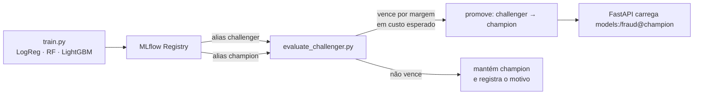

# Sprint 13 — Champion/Challenger e modelos modernos de tabular

**Status:** Planejada 📋
**Fase:** 2 — Laboratório contínuo (Sprints 13–18)
**Custo:** zero (100% local)

---

## Objetivo

Trocar a promoção "o melhor da rodada vira Production" por um **ciclo champion/challenger**: todo modelo novo entra como `challenger`, é comparado com o `champion` atual em dados fora do treino e só é promovido se vencer por uma margem definida, numa métrica de negócio e não só em ROC-AUC.

## Problema de Negócio

Hoje `register_model.py` promove automaticamente quem tem a melhor métrica do run. Em fraude, isso tem dois riscos:

1. **Regressão silenciosa** — um retreino disparado pelo DAG do Sprint 11 pode gerar um modelo pior que o atual e ir para produção sem ninguém ver.
2. **Métrica errada** — ROC-AUC trata igual um falso negativo (fraude que passou = dinheiro perdido) e um falso positivo (cliente bloqueado = atrito). O negócio não trata os dois igual.

Além disso, LogisticRegression e RandomForest (Sprint 3) não são o estado da arte para tabular. Gradient boosting (LightGBM/XGBoost) é o padrão de mercado.

---

## Arquitetura alvo



---

## Decisões a discutir no sprint

| Decisão | Opções | Ponto de atenção |
|---|---|---|
| Algoritmo novo | LightGBM · XGBoost · CatBoost | Velocidade de treino × suporte nativo a desbalanceamento |
| Métrica de promoção | ROC-AUC · PR-AUC · **custo esperado** (FN×R$ + FP×R$) | PR-AUC é mais honesta com 0,17% de positivos; custo traduz para o negócio |
| Escolha do threshold | 0,5 fixo · otimizado por custo · por recall mínimo | Threshold faz parte do modelo e precisa ser versionado junto |
| Margem de vitória | qualquer ganho · margem fixa · teste estatístico (bootstrap) | Evita promover por ruído |
| Onde a regra vive | dentro do `register_model.py` · script/task separado | Separar facilita reaproveitar no DAG |

---

## Entregáveis previstos

```
pipelines/
├── train.py                  # + LightGBM/XGBoost no dicionário CLASSIFIERS
├── evaluate_challenger.py    # novo: champion × challenger em holdout fixo
└── register_model.py         # passa a registrar como challenger, não promove direto
airflow/dags/
└── fraud_retraining_dag.py   # + task evaluate_challenger antes da promoção
tests/
└── test_evaluate_challenger.py
```

## Conceitos a aprender

- Champion/challenger, shadow deployment e A/B test: diferenças e quando usar cada um
- Métricas para classes desbalanceadas: PR-AUC, recall@precisão, matriz de custo
- Calibração de probabilidade (por que o score de um GBM não é uma probabilidade real)
- Threshold como artefato versionado
- Bootstrap para intervalo de confiança da diferença entre modelos

## Critério de pronto

- [ ] Retreino nunca promove sozinho um modelo pior que o champion
- [ ] A decisão (promoveu ou não, e por quê) fica registrada como tag no MLflow
- [ ] A API continua servindo `@champion` sem mudar código
- [ ] Testes cobrindo os dois caminhos (vence / não vence)

## Perguntas de entrevista previstas

- Seu novo modelo tem ROC-AUC maior, mas o time de fraude reclama. O que pode estar acontecendo?
- Como você escolhe o threshold de um classificador de fraude?
- Champion/challenger offline × shadow × A/B online: quando cada um basta?

---

## Perguntas de Validação

> *(Preencher durante o sprint)*

## Code Review

> *(Preencher ao final do sprint)*

## Perguntas de Entrevista

> *(Preencher ao final do sprint)*
