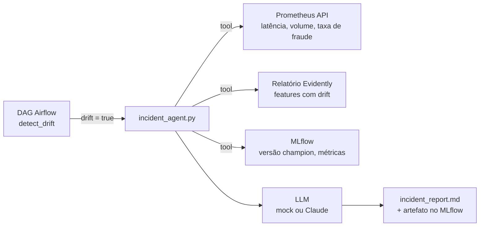

# Sprint 14 — Agente de incidentes: LLM sobre a observabilidade

**Status:** Planejada 📋
**Fase:** 2 — Laboratório contínuo (Sprints 13–18)
**Custo:** quase zero. Roda com LLM mock por padrão; a chave real da Anthropic é opcional (centavos por relatório com um modelo pequeno, como o Haiku).

---

## Objetivo

Quando o drift dispara, um **agente de IA** lê as métricas do Prometheus (Sprint 7), o relatório do Evidently (Sprint 8) e o histórico do registry (Sprint 4), e escreve um **relatório de incidente em linguagem natural**: o que aconteceu, quais features mudaram, impacto provável e próximo passo recomendado.

## Problema de Negócio

O sistema já detecta drift e retreina sozinho, mas a pessoa de plantão recebe um JSON do Evidently e um gráfico no Grafana, e precisa interpretar tudo às 3h da manhã. Um resumo confiável reduz o tempo até a decisão (MTTR) e deixa trilha escrita para auditoria, algo que em fraude é exigência regulatória.

É aqui que o lab passa de MLOps para **MLOps + LLMOps**, o perfil mais pedido hoje.

---

## Arquitetura alvo



---

## Decisões a discutir no sprint

| Decisão | Opções | Ponto de atenção |
|---|---|---|
| Padrão | prompt único com contexto colado · **agente com tool-calling** | Tool-calling escala melhor, mas é mais difícil de testar |
| Provider | mock determinístico · Anthropic SDK direto · framework (LangGraph etc.) | SDK direto ensina o mecanismo; framework esconde |
| Saída | texto livre · **JSON estruturado + markdown** | Estrutura permite validar e testar |
| Gatilho | task nova no DAG · webhook do Alertmanager | O DAG já tem o branch de drift pronto |
| Alucinação | confiar no texto · **toda afirmação cita a métrica de origem** | Base para os evals do Sprint 16 |

---

## Entregáveis previstos

```
agents/
├── incident_agent.py     # loop do agente + definição das tools
├── tools.py              # query_prometheus, read_evidently_report, get_champion_info
├── llm.py                # interface: MockLLM | AnthropicLLM (troca por env var)
└── prompts/incident.md
airflow/dags/
└── fraud_retraining_dag.py   # + task write_incident_report no ramo de drift
tests/
└── test_incident_agent.py    # com MockLLM, sem rede
```

## Conceitos a aprender

- Tool use / function calling: como o modelo decide chamar uma ferramenta
- Saída estruturada e validação com Pydantic
- Grounding: obrigar o modelo a citar a fonte de cada número
- Offline-first: desenvolver e testar com mock, ligar o modelo real por configuração
- Custo e latência por chamada; quando um modelo pequeno basta

## Critério de pronto

- [ ] Drift simulado gera um `incident_report.md` registrado como artefato no MLflow
- [ ] Funciona sem chave de API (mock) e com `ANTHROPIC_API_KEY` definida
- [ ] Todo número citado no relatório bate com a fonte (teste automatizado)
- [ ] Nenhuma chave em código, log ou imagem Docker

## Perguntas de entrevista previstas

- Como você impede um LLM de inventar números num relatório operacional?
- Agente com tools × RAG × prompt com contexto: quando usar cada um?
- Como testar em CI um componente que depende de um LLM?

---

## Perguntas de Validação

> *(Preencher durante o sprint)*

## Code Review

> *(Preencher ao final do sprint)*

## Perguntas de Entrevista

> *(Preencher ao final do sprint)*
