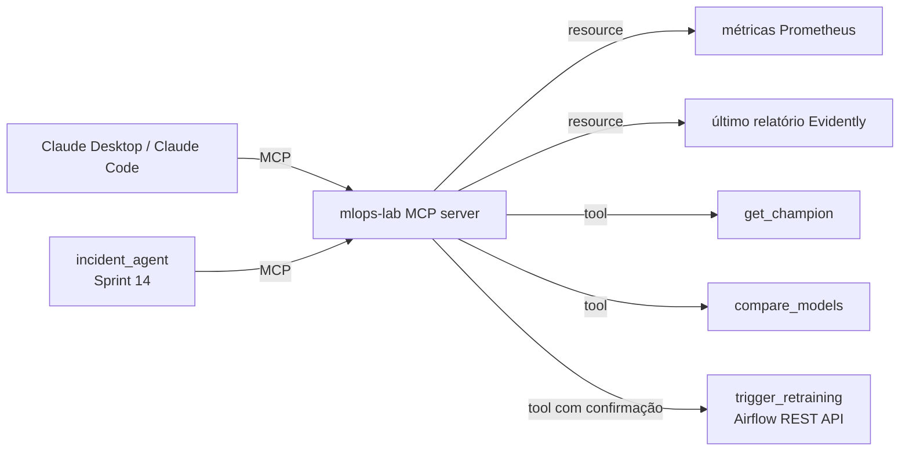

# Sprint 15 — O lab como servidor MCP

**Status:** Planejada 📋
**Fase:** 2 — Laboratório contínuo (Sprints 13–18)
**Custo:** zero

---

## Objetivo

Expor o mlops-lab como um **servidor MCP (Model Context Protocol)**, para que qualquer cliente compatível (Claude Desktop, Claude Code, o próprio agente do Sprint 14) consiga perguntar e agir sobre o sistema em linguagem natural: "qual o drift atual?", "qual modelo está em produção e desde quando?", "dispara um retreino".

## Problema de Negócio

No Sprint 14, as tools do agente ficaram presas dentro de um script. Com MCP, elas viram uma **interface padrão**: escritas uma vez e usadas por qualquer cliente. É o mesmo salto que uma API REST trouxe em relação a funções internas. Também reaproveita direto o seu estudo de MCP (`estudos/MCP`, 8 sprints) num caso real.

---

## Arquitetura alvo



---

## Decisões a discutir no sprint

| Decisão | Opções | Ponto de atenção |
|---|---|---|
| Transporte | stdio · Streamable HTTP | stdio para uso local; HTTP exige autenticação (Sprint 4 do estudo de MCP) |
| Tool × resource | o que é leitura (resource) e o que é ação (tool) | Ação com efeito colateral precisa de outra proteção |
| Ações perigosas | permitir · **exigir confirmação** · só leitura | `trigger_retraining` gasta recurso e muda produção |
| Reuso | reescrever as tools · **o agente do Sprint 14 passa a consumir o MCP** | Uma fonte da verdade para as tools |

---

## Entregáveis previstos

```
mcp_server/
├── server.py          # FastMCP: tools + resources
├── airflow_client.py  # dispara DAG via REST API do Airflow
└── README.md          # como plugar no Claude Desktop / Claude Code
agents/
└── incident_agent.py  # passa a usar o servidor MCP como fonte das tools
tests/
└── test_mcp_server.py # via ClientSession real, como no estudo de MCP
```

## Conceitos a aprender

- Tools, resources e prompts no MCP aplicados a um sistema real
- Princípio do menor privilégio para agentes: leitura livre, escrita protegida
- Idempotência de ações disparadas por agente (o que acontece se ele chamar duas vezes?)
- Auditoria: quem (qual cliente) disparou qual ação

## Critério de pronto

- [ ] Claude Desktop ou Claude Code responde "qual modelo está em produção?" consultando o lab
- [ ] `trigger_retraining` não executa sem confirmação explícita
- [ ] O agente do Sprint 14 funciona consumindo o servidor MCP
- [ ] Testes com `ClientSession` real

## Perguntas de entrevista previstas

- Que riscos aparecem quando você dá a um agente de IA o poder de agir em produção?
- MCP × API REST comum: o que o protocolo resolve que uma API não resolve?
- Como você audita ações feitas por agentes?

---

## Perguntas de Validação

> *(Preencher durante o sprint)*

## Code Review

> *(Preencher ao final do sprint)*

## Perguntas de Entrevista

> *(Preencher ao final do sprint)*
