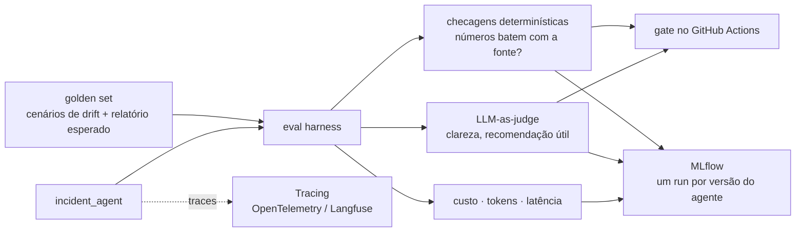

# Sprint 16 — Evals e observabilidade de LLM

**Status:** Planejada 📋
**Fase:** 2 — Laboratório contínuo (Sprints 13–18)
**Custo:** zero com mock e ferramenta self-hosted; centavos se o juiz for um LLM real

---

## Objetivo

Fazer com o agente dos Sprints 14 e 15 o que os Sprints 7 e 8 fizeram com o modelo de fraude: **medir qualidade, custo e latência continuamente** e bloquear no CI qualquer mudança que piore o agente.

## Problema de Negócio

Um modelo clássico tem ROC-AUC. Um agente que escreve relatórios não tem métrica pronta, e trocar o prompt ou o modelo pode piorar o resultado sem que ninguém perceba. Sem evals, cada mudança no agente é um palpite. Com evals no CI, ela vira um experimento comparável, como no MLflow.

---

## Arquitetura alvo



---

## Decisões a discutir no sprint

| Decisão | Opções | Ponto de atenção |
|---|---|---|
| Golden set | escrito à mão · gerado a partir de drifts simulados | Começar pequeno (10–20 casos) e bom |
| Tipo de avaliação | **determinística primeiro** · LLM-as-judge depois | Juiz LLM também erra e precisa ser calibrado |
| Tracing | OpenTelemetry puro · Langfuse self-hosted · MLflow Tracing | MLflow já está na stack |
| Gate de CI | threshold fixo · não piorar em relação ao baseline | Igual ao gate de ROC-AUC dos seus outros projetos |
| Onde guardar resultados | arquivo · **MLflow** (um experimento "agent-evals") | Compara versões de prompt como compara modelos |

---

## Entregáveis previstos

```
evals/
├── golden_set/            # cenários + expectativas
├── run_evals.py           # roda o agente em todos os casos e gera métricas
├── judges.py              # checagens determinísticas + juiz LLM (mockável)
└── thresholds.yaml
.github/workflows/
└── ci.yml                 # + job de evals bloqueando regressão
```

## Conceitos a aprender

- Evals offline × online, golden set e regressão de prompt
- LLM-as-judge: vieses conhecidos e como calibrar com amostra humana
- Tracing de agente: spans por chamada de LLM e por tool
- Custo como métrica de primeira classe (tokens por relatório, custo por incidente)
- Versionar prompt como se versiona modelo

## Critério de pronto

- [ ] `make evals` roda o golden set e registra um run no MLflow
- [ ] Um PR que piora o agente quebra o CI
- [ ] Cada relatório tem trace com custo e latência por etapa
- [ ] Juiz LLM validado contra pelo menos 10 julgamentos humanos

## Perguntas de entrevista previstas

- Como você avalia a qualidade de um sistema com LLM antes de ir para produção?
- Quais os riscos de usar um LLM para julgar outro LLM?
- Que métricas você monitora num agente em produção?

---

## Perguntas de Validação

> *(Preencher durante o sprint)*

## Code Review

> *(Preencher ao final do sprint)*

## Perguntas de Entrevista

> *(Preencher ao final do sprint)*
