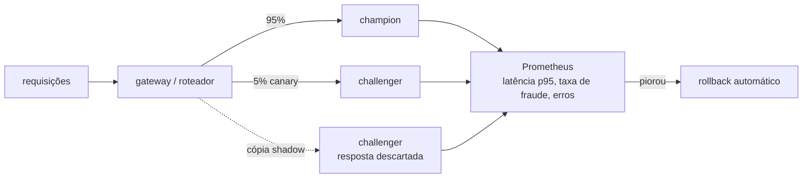

# Sprint 17 — Serving em escala e deploy progressivo

**Status:** Planejada 📋
**Fase:** 2 — Laboratório contínuo (Sprints 13–18)
**Custo:** zero (roda no Kind do Sprint 10)

---

## Objetivo

Levar o champion/challenger do Sprint 13 para o **mundo online**: servir os dois modelos lado a lado no Kubernetes, com o challenger primeiro em modo **shadow** (recebe o tráfego, mas a resposta é descartada) e depois em **canary** (recebe uma fatia real do tráfego), com rollback automático se as métricas piorarem.

## Problema de Negócio

O champion/challenger do Sprint 13 é offline: compara modelos em dados históricos. Mas modelo de fraude bom no holdout pode falhar com o tráfego de hoje, ou pode ser lento demais para a regra de negócio de responder em menos de X ms antes de autorizar a compra. A única forma segura de descobrir isso é expor o modelo ao tráfego real aos poucos.

---

## Arquitetura alvo



---

## Decisões a discutir no sprint

| Decisão | Opções | Ponto de atenção |
|---|---|---|
| Framework de serving | manter FastAPI · BentoML · KServe · Ray Serve | KServe é o padrão em K8s, mas pesado para o Kind |
| Divisão de tráfego | na própria API · Ingress/Service Mesh · Argo Rollouts | Argo Rollouts automatiza canary + análise |
| Shadow | duplicar na API · espelhamento no mesh | Duplicar na API é simples, mas acopla |
| Critério de rollback | latência p95 · erro HTTP · desvio da taxa de fraude prevista | Taxa de fraude prevista é um sinal precoce de problema |
| Performance | modelo como está · ONNX · batching | Medir antes de otimizar |

---

## Entregáveis previstos

```
deployment/k8s/
├── champion-deployment.yaml
├── challenger-deployment.yaml
└── rollout.yaml           # se Argo Rollouts: estratégia canary + AnalysisTemplate
app/
└── main.py                # + label de versão nas métricas Prometheus
tests/load/
└── locustfile.py          # teste de carga para medir latência p95/p99
```

## Conceitos a aprender

- Shadow × canary × blue-green × A/B: o que cada um protege
- Latência de cauda (p95/p99) e por que média engana
- Rollback automático guiado por métricas
- Teste de carga (Locust/k6) e capacity planning
- Quando otimizar o modelo (ONNX, quantização) compensa

## Critério de pronto

- [ ] Champion e challenger rodam lado a lado no Kind, com métricas separadas por versão
- [ ] Modo shadow funcionando sem afetar a resposta ao cliente
- [ ] Canary com rollback automático demonstrado (forçando um challenger ruim)
- [ ] Relatório de teste de carga com p95/p99 dos dois modelos

## Perguntas de entrevista previstas

- Como você colocaria um novo modelo de fraude em produção sem risco?
- Diferença entre shadow e canary, e quando cada um não basta?
- Seu p50 está ótimo e o p99 está ruim. O que você investiga?

---

## Perguntas de Validação

> *(Preencher durante o sprint)*

## Code Review

> *(Preencher ao final do sprint)*

## Perguntas de Entrevista

> *(Preencher ao final do sprint)*
