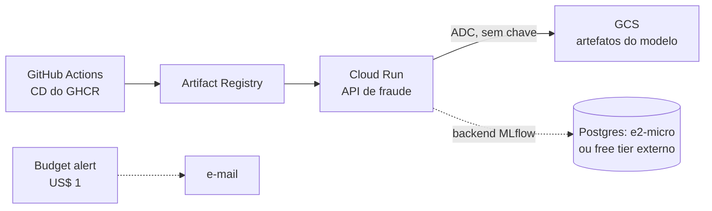

# Sprint 18 — Deploy real em nuvem com custo controlado

**Status:** Planejada 📋 (opcional: exige decisão de custo antes de começar)
**Fase:** 2 — Laboratório contínuo (Sprints 13–18)
**Custo:** desenhado para ficar em zero, mas envolve conta GCP real. Ver "Guarda-corpos de custo".

---

## Objetivo

Fechar o que o Sprint 12 deixou como exercício: **aplicar de verdade** o Terraform no GCP, usando só serviços com free tier permanente, com teardown fácil e alerta de orçamento. A API de fraude e o artifact store passam a rodar na nuvem por tempo limitado, o suficiente para provar que o caminho funciona.

## Problema de Negócio

"Escrevi o Terraform, mas nunca apliquei" é a lacuna mais visível do projeto numa entrevista. Provisionar, operar e destruir infraestrutura real (com IAM, rede e custo de verdade) é uma habilidade diferente de escrever `.tf`, e é ela que o mercado cobra.

---

## Arquitetura alvo



---

## Guarda-corpos de custo (decidir antes de começar)

- **Sem Cloud SQL**, porque não tem free tier permanente (motivo da decisão do Sprint 12). Alternativas: Postgres numa VM `e2-micro` (free tier) ou um Postgres gerenciado gratuito externo.
- **Budget alert** de US$ 1 criado *antes* de qualquer recurso.
- `min_instances = 0` no Cloud Run (escala a zero).
- `make gcp-destroy` testado logo no primeiro dia.
- Tudo com labels `project=mlops-lab` para auditar a fatura.

---

## Decisões a discutir no sprint

| Decisão | Opções | Ponto de atenção |
|---|---|---|
| Banco do MLflow | VM e2-micro · Postgres externo gratuito · servir o modelo sem MLflow na nuvem | A API só precisa do artefato, não do tracking server |
| Estado do Terraform | local · bucket GCS com lock | Bucket é o padrão de time |
| Autenticação do CI | chave JSON · **Workload Identity Federation** | WIF elimina segredo de longa duração |
| Escopo | só a API · API + MLflow · tudo | Começar só pela API |

---

## Entregáveis previstos

```
deployment/gcp/
├── backend.tf            # estado remoto
├── budget.tf             # alerta de orçamento
├── cloud_run.tf          # revisado para min_instances = 0
└── wif.tf                # Workload Identity Federation para o GitHub Actions
.github/workflows/
└── deploy-gcp.yml        # deploy manual (workflow_dispatch), nunca automático
Makefile                  # + gcp-plan / gcp-apply / gcp-destroy
```

## Conceitos a aprender

- Terraform na prática: plan × apply, estado remoto, drift de infraestrutura
- IAM de menor privilégio e Workload Identity Federation
- FinOps básico: budget, labels, escala a zero, teardown
- Diferença entre "funciona no Kind" e "funciona no Cloud Run" (cold start, rede, segredos)

## Critério de pronto

- [ ] Alerta de orçamento ativo antes do primeiro recurso
- [ ] API de fraude respondendo numa URL pública do Cloud Run
- [ ] Deploy feito pelo GitHub Actions sem chave JSON
- [ ] `make gcp-destroy` deixa a conta sem recursos (verificado)
- [ ] Fatura do período: US$ 0,00

## Perguntas de entrevista previstas

- Como você evita que um ambiente de estudo gere uma fatura surpresa?
- Por que Workload Identity Federation em vez de uma chave de service account?
- O que muda ao levar uma API de ML do Kubernetes para o Cloud Run?

---

## Perguntas de Validação

> *(Preencher durante o sprint)*

## Code Review

> *(Preencher ao final do sprint)*

## Perguntas de Entrevista

> *(Preencher ao final do sprint)*
